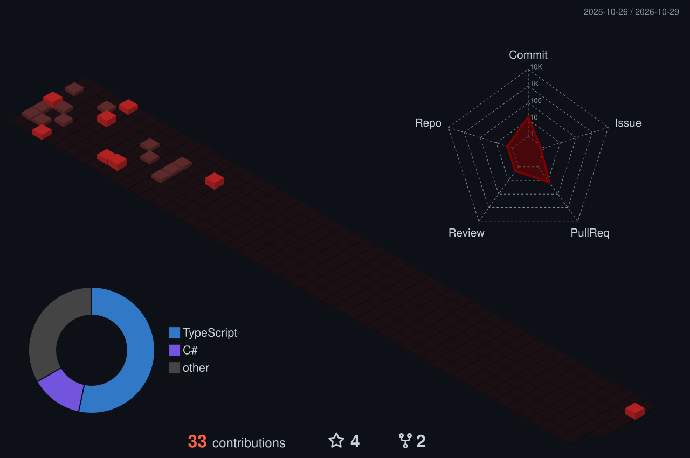

<div align="center">

[](https://git.io/typing-svg)

<a href="https://www.instagram.com/izgpbela/" target="_blank"></a>
<a href="https://youtube.com/@izabelapereira20" target="_blank"></a>
<a href="mailto:izgpbela.dev@gmail.com"></a>
<a href="https://www.linkedin.com/in/izabela-gomes-development/" target="_blank"></a>

</div>

---

## 🍷 `whoami`

```java
@Service
public class IzabelaGomes implements BackendDeveloper {

    private final String role      = "Back-end Developer";
    private final String location  = "Brasil 🇧🇷";
    private final String[] mainStack = { "Java", "Spring", "PHP", "Laravel", "Node.js" };
    private final String[] learning  = { "Cloud (AWS)", "Docker", "Arquitetura de software" };

    @Override
    public String motto() {
        return "Em busca de inovação e aprendizado contínuo.";
    }

    @Override
    public boolean openToCollaborate() {
        return true; // bora codar junto? ☕
    }
}
```

---

## 📊 GitHub em números

<div align="center">
  
  
</div>

<div align="center">
  
</div>

---

## 🏙️ Minha cidade de commits

<div align="center">
  
  <br/>
  <sub>Cada prédio é um dia de código. Quanto mais alto, mais commits. 🧱</sub>
</div>

---

## 🧠 My language stacks

<p align="center">
  
</p>

## 🗄️ Banco de dados & Cloud

<p align="center">
  
</p>

## ⚙️ Frameworks & Libraries

<p align="center">
  
</p>

---

<details>
<summary><b>🔭 No que estou trabalhando agora</b></summary>
<br/>

- 🌱 Aprofundando em **Spring Boot** e boas práticas de APIs REST
- ☁️ Estudando deploy e infraestrutura na **AWS**
- 🐳 Containerizando projetos com **Docker**
- 📺 Criando conteúdo no [YouTube](https://youtube.com/@izabelapereira20)

</details>

<details>
<summary><b>☕ Curiosidades sobre mim</b></summary>
<br/>

- Prefiro um bom log de erro a um sistema que falha em silêncio
- Meu tema favorito é sempre o dark mode (dá para perceber, né?)
- Acredito que código bom é código que outra pessoa entende

</details>

<br/>

<div align="center">
  
</div>


